# PROJECT MEMORY — Binyo POS

Gunakan file ini sebagai peta dokumen dan ringkasan keputusan aktif. Detail lengkap tetap berada pada dokumen sumber yang ditautkan.

## 1. Produk

| Permukaan | Pengguna | Tanggung jawab | Dokumen |
|---|---|---|---|
| Backoffice web | Pemilik, manajer, gudang | Katalog, stok, pembelian, laporan, outlet, dan akses | [`product/backoffice.md`](product/backoffice.md) |
| POS mobile | Kasir, manajer outlet | Penjualan, pembayaran, shift, struk, dan sinkronisasi | [`product/pos-mobile.md`](product/pos-mobile.md) |

## 2. Alur bisnis utama

```mermaid
flowchart LR
    Setup[Siapkan bisnis, outlet, tim, perangkat] --> Catalog[Susun katalog dan harga]
    Catalog --> Purchase[Pembelian dan penerimaan]
    Purchase --> Stock[Stok tersedia]
    Stock --> Shift[Buka shift kasir]
    Shift --> Sale[Penjualan dan pembayaran]
    Sale --> Movement[Pergerakan stok dan kas]
    Movement --> Close[Tutup dan rekonsiliasi shift]
    Close --> Report[Laporan pemilik]
```

## 3. Batas MVP

### Termasuk

- Organisasi, outlet, pengguna, peran, dan perangkat.
- Produk, varian/SKU, kategori, modifier, harga, pajak, dan resep ringan.
- Penjualan, pembayaran manual, struk, shift, kas, void, dan refund.
- Ledger stok, opname, penyesuaian, transfer, pemasok, PO, dan penerimaan.
- Dashboard dan laporan operasional.
- Operasi offline sementara dengan sinkronisasi idempotent.

### Ditunda

- General ledger, payroll, waralaba, komisi, dan marketing automation.
- Loyalty kompleks, marketplace, toko online, kiosk, serta manajemen meja.
- QRIS dinamis sebelum payment provider dipilih.

## 4. Keputusan data

- Varian/SKU adalah unit jual; produk tanpa pilihan memiliki satu varian default.
- Transaksi menyimpan snapshot nama, harga, pajak, biaya, dan modifier.
- Pergerakan stok adalah sumber kebenaran; saldo adalah agregasi/cache.
- Transaksi selesai tidak dihapus atau ditimpa; koreksi memakai void, refund, atau reversal.
- Idempotency transaksi dan pembayaran dilindungi unique constraint.
- Semua data bisnis dibatasi `business_id` dan izin outlet.

Detail: [`architecture/data-model.md`](architecture/data-model.md).

## 5. Peran dan approval

| Tindakan | Pemilik | Manajer | Kasir | Gudang |
|---|---:|---:|---:|---:|
| Ubah produk/harga | Ya | Opsional | Tidak | Tidak |
| Diskon manual | Ya | Ya | Sesuai batas | Tidak |
| Void/refund | Ya | Ya | Dengan persetujuan | Tidak |
| Koreksi stok | Ya | Ya | Tidak | Sesuai izin |
| Tutup shift orang lain | Ya | Ya | Tidak | Tidak |
| Lihat laba | Ya | Opsional | Tidak | Tidak |

Hak akses disimpan sebagai kemampuan. Nama peran hanya preset.

## 6. Fondasi teknis yang direkomendasikan

| Area | Rekomendasi | Status |
|---|---|---|
| Backend/API | Laravel modular monolith | Belum dikunci |
| Backoffice | Inertia + Vue + TypeScript | Belum dikunci |
| POS mobile | Flutter, Android-first | Wajib validasi hardware |
| Database server | PostgreSQL | Direkomendasikan |
| Database lokal POS | SQLite | Direkomendasikan |
| Queue/cache | Database queue dahulu; Redis saat terbukti perlu | Direkomendasikan |

Detail: [`architecture/technical-foundation.md`](architecture/technical-foundation.md).

## 7. Aturan kerja

- Branch kerja dibuat dari `main` dan memakai prefix yang disetujui.
- Commit memakai Conventional Commits dan satu perubahan logis.
- `bin/verify.sh` wajib lulus sebelum commit dan PR.
- PR menargetkan `main`; CI `Tests & Lint` wajib hijau.
- Test database tidak boleh menunjuk database produksi.
- Dokumentasi diperbarui dalam perubahan yang sama saat perilaku, data, API, atau operasi berubah.

Detail: [`conventions/git-workflow.md`](conventions/git-workflow.md) dan [`conventions/testing.md`](conventions/testing.md).

## 8. Peta dokumen

| Area | Sumber |
|---|---|
| Scope dan kebutuhan | [`product/product-requirements.md`](product/product-requirements.md) |
| Backoffice | [`product/backoffice.md`](product/backoffice.md) |
| POS mobile | [`product/pos-mobile.md`](product/pos-mobile.md) |
| Model data | [`architecture/data-model.md`](architecture/data-model.md) |
| Teknis dan keamanan | [`architecture/technical-foundation.md`](architecture/technical-foundation.md) |
| Delivery | [`delivery/roadmap.md`](delivery/roadmap.md) |
| Benchmark | [`references/pos-benchmark.md`](references/pos-benchmark.md) |
| Convention | [`conventions/README.md`](conventions/README.md) |

## 9. Keputusan terbuka

- Segmen pilot: retail, F&B, atau hybrid.
- Jumlah outlet/perangkat dan batas durasi offline.
- Model printer, scanner, cash drawer, dan Android minimum.
- Payment provider dan metode QRIS.
- Pajak, service charge, aturan pembulatan, dan kebijakan stok minus.
- Kebutuhan resep/bahan baku serta integrasi akunting.
