# PROJECT MEMORY — Binyo POS

Gunakan file ini sebagai peta dokumen dan ringkasan keputusan aktif. Detail lengkap tetap berada pada dokumen sumber yang ditautkan.

## 1. Produk

| Permukaan | Pengguna | Tanggung jawab | Dokumen |
|---|---|---|---|
| Backoffice web | Pemilik, manajer, gudang | Katalog, stok, pembelian, laporan, outlet, dan akses | [`product/backoffice.md`](product/backoffice.md) |
| POS mobile | Kasir, manajer outlet | Penjualan, pembayaran, shift, struk, dan sinkronisasi | [`product/pos-mobile.md`](product/pos-mobile.md) |

Pilot pertama menargetkan kedai kopi: satu outlet, satu pemilik, satu manajer, satu atau lebih kasir, satu atau lebih staf gudang, satu perangkat utama, dan satu perangkat cadangan bila tersedia. Model data dan akses tetap mendukung perluasan menjadi dua atau tiga outlet tanpa migrasi konsep.

Arah visual `Counterline` memakai operational rail sebagai elemen khas lintas backoffice dan POS. Detail kanonis: [`product/interface-design.md`](product/interface-design.md).

## 2. Alur bisnis utama

```mermaid
flowchart LR
    Setup[Siapkan bisnis, outlet, tim, perangkat] --> Catalog[Susun katalog dan harga]
    Catalog --> Purchase[Pembelian dan penerimaan]
    Purchase --> Stock[Stok tersedia]
    Stock --> Shift[Buka shift kasir]
    Shift --> Sale[Penjualan dan pembayaran]
    Sale --> Movement[Pergerakan stok dan kas]
    Movement --> Close[Tutup dan rekonsiliasi shift]
    Close --> Report[Laporan pemilik]
```

## 3. Batas MVP

### Termasuk

- Organisasi, outlet, pengguna, peran, dan perangkat.
- Produk, varian/SKU, kategori, modifier, harga, pajak, dan resep ringan.
- Penjualan, split bill per item, pembayaran manual, struk, shift, kas, void, dan refund.
- Ledger stok, opname, penyesuaian, transfer, pemasok, PO, dan penerimaan.
- Dashboard dan laporan operasional.
- Operasi offline sementara dengan sinkronisasi idempotent.
- Replica operasional sanitasi dengan switch per outlet dan retensi 30 hari.

### Struktur menu backoffice

- Beranda.
- Penjualan.
- Produk.
- Persediaan.
- Laporan.
- Operasional.
- Pengaturan.

Master data kecil, pembelian, pelanggan, dan proses transfer tidak menjadi menu utama terpisah.

### Ditunda

- General ledger, payroll, waralaba, komisi, dan marketing automation.
- Loyalty kompleks, marketplace, toko online, kiosk, serta manajemen meja.
- QRIS dinamis sebelum payment provider dipilih.

## 4. Keputusan data

- Varian/SKU adalah unit jual; produk tanpa pilihan memiliki satu varian default.
- Transaksi menyimpan snapshot nama, harga, pajak, biaya, dan modifier.
- Pergerakan stok adalah sumber kebenaran; saldo adalah agregasi/cache.
- Setiap SKU memiliki satu base unit; satuan beli dikonversi memakai faktor yang disimpan sebagai snapshot.
- Penerimaan barang memperbarui HPP rata-rata bergerak per SKU dan outlet.
- Penjualan menyimpan snapshot HPP produk atau resep; histori laba tidak berubah karena pembelian berikutnya.
- Larangan stok minus aktif secara default per outlet; bila dinonaktifkan, transaksi tetap berjalan tetapi saldo minus ditandai untuk rekonsiliasi.
- Split bill mengalokasikan pembayaran ke baris atau sebagian jumlah item tanpa membatalkan atau menggandakan transaksi asal.
- Transaksi selesai tidak dihapus atau ditimpa; koreksi memakai void, refund, atau reversal.
- Idempotency transaksi dan pembayaran dilindungi unique constraint.
- Pembayaran non-tunai manual direkonsiliasi tanpa mengubah transaksi asli.
- Shift offline baru final setelah seluruh urutan transaksi sampai batas penutupan diterima server.
- Target operasi offline adalah satu shift atau delapan jam; perangkat tidak dapat membuka shift berikutnya sebelum sinkronisasi aman.
- Semua data bisnis dibatasi `business_id` dan izin outlet.
- Database utama selalu menjadi sumber kebenaran; POS tidak pernah menulis langsung ke database replica.
- Saat switch replica outlet aktif, commit transaksi utama membuat outbox event yang dikirim worker ke database replica.
- Replica mempertahankan nominal transaksi asli, tetapi tidak menerima identitas pelanggan, HPP, laba, kredensial, atau catatan internal.
- Laporan resmi dan pajak hanya membaca database utama; replica selalu berlabel non-authoritative.

Detail: [`architecture/data-model.md`](architecture/data-model.md).

## 5. Peran dan approval

| Tindakan | Pemilik | Manajer | Kasir | Gudang |
|---|---:|---:|---:|---:|
| Ubah produk/harga | Ya | Opsional | Tidak | Tidak |
| Diskon manual | Ya | Ya | Sesuai batas | Tidak |
| Void/refund | Ya | Ya | Dengan persetujuan | Tidak |
| Balikkan pembayaran salah | Ya | Ya | Dengan persetujuan | Tidak |
| Koreksi stok | Ya | Ya | Tidak | Sesuai izin |
| Tutup shift orang lain | Ya | Ya | Tidak | Tidak |
| Lihat laba | Ya | Opsional | Tidak | Tidak |
| Kelola switch replica | Ya | Tidak | Tidak | Tidak |
| Lihat laporan replica | Ya | Opsional | Tidak | Tidak |

Hak akses disimpan sebagai kemampuan dan ditugaskan per outlet. Nama peran hanya preset; tab dan tindakan POS mengikuti izin pengguna. Pembatalan transaksi dan pembalikan pembayaran membutuhkan PIN pemilik atau manajer serta alasan.

## 6. Fondasi teknis yang direkomendasikan

| Area | Rekomendasi | Status |
|---|---|---|
| Backend/API | Laravel modular monolith | Belum dikunci |
| Backoffice | Inertia + Vue + TypeScript | Belum dikunci |
| POS mobile | Flutter, Android-first | Wajib validasi hardware |
| Database server | PostgreSQL | Direkomendasikan |
| Database lokal POS | SQLite | Direkomendasikan |
| Queue/cache | Database queue dahulu; Redis saat terbukti perlu | Direkomendasikan |

Detail: [`architecture/technical-foundation.md`](architecture/technical-foundation.md).

## 7. Aturan kerja

- Branch kerja dibuat dari `main` dan memakai prefix yang disetujui.
- Commit memakai Conventional Commits dan satu perubahan logis.
- `bin/verify.sh` wajib lulus sebelum commit dan PR.
- PR menargetkan `main`; CI `Tests & Lint` wajib hijau.
- Test database tidak boleh menunjuk database produksi.
- Dokumentasi diperbarui dalam perubahan yang sama saat perilaku, data, API, atau operasi berubah.

Detail: [`conventions/git-workflow.md`](conventions/git-workflow.md) dan [`conventions/testing.md`](conventions/testing.md).

## 8. Peta dokumen

| Area | Sumber |
|---|---|
| Scope dan kebutuhan | [`product/product-requirements.md`](product/product-requirements.md) |
| Backoffice | [`product/backoffice.md`](product/backoffice.md) |
| POS mobile | [`product/pos-mobile.md`](product/pos-mobile.md) |
| Sistem antarmuka | [`product/interface-design.md`](product/interface-design.md) |
| Model data | [`architecture/data-model.md`](architecture/data-model.md) |
| Teknis dan keamanan | [`architecture/technical-foundation.md`](architecture/technical-foundation.md) |
| Delivery | [`delivery/roadmap.md`](delivery/roadmap.md) |
| Benchmark | [`references/pos-benchmark.md`](references/pos-benchmark.md) |
| Audit menu Vireo | [`references/vireo-menu-audit.md`](references/vireo-menu-audit.md) |
| Matriks fitur Vireo | [`references/vireo-feature-matrix.md`](references/vireo-feature-matrix.md) |
| Validasi HPP Vireo | [`references/vireo-hpp-validation.md`](references/vireo-hpp-validation.md) |
| Convention | [`conventions/README.md`](conventions/README.md) |

## 9. Keputusan terbuka

- Model perangkat Android, printer, scanner, cash drawer, dan kebutuhan kitchen printer pilot.
- Payment provider dan metode QRIS.
- Pajak, service charge, dan tarif yang berlaku pada kedai pilot.
- Kebutuhan impor data lama serta bentuk ekspor/integrasi akunting.
