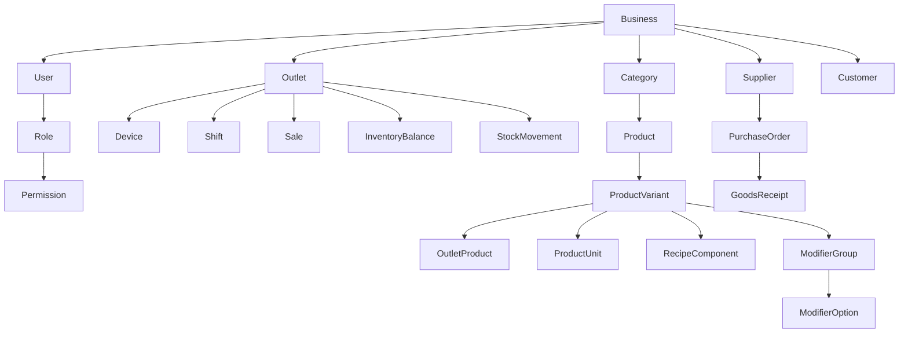

# Model Data

Dokumen ini menetapkan bentuk dan aturan data, bukan skema SQL final.

## 1. Prinsip

- Semua tabel bisnis memiliki `business_id` untuk isolasi tenant.
- Semua waktu tersimpan dalam UTC dan ditampilkan memakai zona waktu outlet.
- Total transaksi dan pembayaran disimpan sebagai integer satuan mata uang terkecil; untuk IDR berarti rupiah tanpa pecahan.
- Kuantitas dan biaya per base unit memakai fixed decimal, bukan floating point. Nilai ledger dibulatkan ke rupiah saat posting.
- Record transaksi penting tidak dihapus permanen.
- Snapshot transaksi menjaga histori saat nama, harga, pajak, atau biaya produk berubah.
- Ledger pergerakan adalah sumber kebenaran stok; saldo adalah hasil agregasi/cache.

## 2. Relasi inti



## 3. Organisasi dan akses

### businesses

- `id`
- `name`
- `timezone_default`
- `currency`
- `status`

### outlets

- `id`, `business_id`
- `code`, `name`
- `address`
- `timezone`
- `receipt_prefix`
- `prevent_negative_stock`, default aktif
- `replica_enabled`, default `false`
- `status`

### users

- `id`, `business_id`
- `name`, `email_or_phone`
- `password_hash`
- `pin_hash` opsional
- `status`, `last_login_at`

### roles, permissions, user_outlet_roles

Peran adalah kumpulan izin. Penugasan menyebut pengguna, outlet, dan peran agar seorang manajer tidak otomatis melihat semua outlet.

Persetujuan PIN menyimpan tindakan, record, peminta, penyetuju, outlet, perangkat, alasan, dan waktu. Mengetahui PIN tidak mengubah role pengguna aktif.

### devices

- `id`, `business_id`, `outlet_id`
- `code`, `name`, `platform`
- `installation_id`
- `last_seen_at`, `last_sync_at`
- `revoked_at`

## 4. Katalog

### categories

- `id`, `business_id`
- `parent_id` opsional, maksimal dua tingkat pada MVP
- `name`, `display_order`, `status`

### products

- `id`, `business_id`, `category_id`
- `name`, `description`, `image_path`
- `product_type`: `standard` atau `recipe`
- `tax_profile_id`
- `status`, `display_order`

### product_variants

- `id`, `business_id`, `product_id`
- `sku`, `barcode`, `name`
- `base_unit_id`
- `sell_price`, `default_purchase_cost`
- `track_stock`
- `is_default`, `status`

Produk tanpa pilihan memiliki satu varian default. Semua baris penjualan menunjuk varian, bukan langsung ke produk.

### units dan product_units

`units` menyimpan kode dan jenis satuan, misalnya `pcs`, `gr`, `kg`, `ml`, atau `liter`.

`product_units` menyimpan:

- `product_variant_id`, `unit_id`
- `conversion_factor_to_base`
- `is_purchase_unit`, `is_sale_unit`
- `barcode` opsional

Satu SKU memiliki satu base unit. Konversi tidak boleh melintasi jenis satuan tanpa aturan produk yang eksplisit; `kg` ke `gr` valid, tetapi `liter` ke `pcs` tidak diasumsikan sistem.

### outlet_products

- `outlet_id`, `product_variant_id`
- `is_available`
- `price_override` opsional
- `low_stock_threshold` opsional
- `preparation_station_id` opsional

### preparation_stations

- `id`, `business_id`, `outlet_id`
- `name`, misalnya `Bar` atau `Dapur`
- `printer_profile_id` opsional
- `status`

Kitchen ticket dikelompokkan berdasarkan tujuan persiapan. Koreksi setelah ticket tercetak menghasilkan ticket koreksi yang menunjuk transaksi dan baris asal.

### modifier_groups dan modifier_options

Grup menyimpan nama, minimum, maksimum, dan apakah wajib. Opsi menyimpan nama, tambahan harga, serta SKU bahan opsional bila modifier memengaruhi stok.

### recipe_components

- `parent_variant_id`
- `component_variant_id`
- `quantity_in_base_unit`

Resep selalu disimpan dalam base unit komponen. HPP resep per outlet dihitung dari jumlah komponen dikali `inventory_balances.average_cost` komponen pada outlet tersebut. Modifier yang mengonsumsi stok memakai aturan yang sama.

## 5. Penjualan

### sales

- `id`, `business_id`, `outlet_id`, `device_id`, `shift_id`
- `customer_id` opsional
- `receipt_number`, `device_sequence`, `idempotency_key`
- `status`: `open`, `partially_paid`, `completed`, `voided`, `partially_refunded`, `refunded`
- `subtotal`, `discount_total`, `tax_total`, `service_charge_total`, `grand_total`
- `created_at_device`, `created_at_server`, `synced_at`
- `cashier_user_id`

### sale_lines

- `id`, `sale_id`, `product_variant_id`
- Snapshot: `product_name`, `variant_name`, `sku`, `unit`, `unit_price`, `unit_cost`
- Snapshot pajak: `tax_name`, `tax_rate`, `tax_calculation_type`
- `quantity`, `discount_total`, `service_charge_total`, `tax_total`, `line_total`
- `note`

### sale_line_modifiers

- `sale_line_id`, `modifier_option_id`
- Snapshot nama, harga, biaya, dan jumlah.

### payments

- `id`, `sale_id`, `payment_method_id`
- `amount`, `status`: `draft`, `completed`, atau `reversed`
- `tendered_amount` dan `change_amount` untuk tunai
- `external_reference`
- `verification_status`: `recorded`, `matched`, `disputed`
- `idempotency_key`, `paid_at`, `matched_at`
- `reversal_of_payment_id`, `reversal_reason_id`, dan `approved_by` opsional

### payment_allocations

- `payment_id`, `sale_line_id`
- `quantity`, `amount`

Split bill memakai alokasi pembayaran, bukan menyalin atau membatalkan transaksi. Satu pembayaran dapat menutup beberapa baris; satu baris dengan jumlah lebih dari satu dapat dibagi ke beberapa pembayaran. Transaksi menjadi `completed` hanya bila seluruh grand total telah ditutup pembayaran `completed`.

Diskon tingkat transaksi, service charge, pajak, dan pembulatan dialokasikan proporsional ke baris sebelum split. Sisa pembulatan ditempatkan pada baris terakhir agar jumlah seluruh `sale_lines.line_total` sama dengan `sales.grand_total`.

Pembayaran salah dikoreksi dengan record reversal dan pembayaran pengganti dalam satu transaksi database. Record lama tidak dihapus. Selisih pembulatan ditempatkan pada alokasi pembayaran terakhir.

### payment_reconciliations

- `id`, `business_id`, `outlet_id`, `payment_method_id`
- `business_date`, `expected_amount`, `settled_amount`, `difference`
- `status`: `draft`, `matched`, `difference_accepted`
- `reference`, `note`, `created_by`, `closed_by`

Rekonsiliasi tidak mengubah transaksi atau pembayaran asli. Koreksi memakai record baru dengan alasan dan audit.

### refunds dan refund_lines

Refund menunjuk transaksi serta baris asli, menyimpan alasan, pelaku, penyetuju, nominal, dan keputusan pengembalian stok.

Tidak ada hard delete untuk `sales`, `sale_lines`, `payments`, atau `refunds`.

## 6. Shift dan kas

### shifts

- `id`, `outlet_id`, `device_id`, `business_date`
- `opened_by`, `responsible_user_id`, `closed_by`
- `previous_shift_id` opsional untuk serah terima
- `opening_cash`, `expected_cash`, `counted_cash`, `difference`
- `deposited_cash`, `carried_cash`
- `opening_device_sequence`, `closing_device_sequence`
- `opened_at`, `close_requested_at`, `closed_at`
- `status`: `open`, `closing_pending_sync`, `closed`

Server hanya mengubah shift menjadi `closed` setelah seluruh transaksi perangkat sampai `closing_device_sequence` diterima. Penutupan offline tetap tersimpan lokal sebagai `closing_pending_sync`.

Permintaan penutupan ditolak bila perangkat masih memiliki transaksi `open`, `partially_paid`, pembayaran `draft`, atau command transaksi gagal yang belum diselesaikan. Bill harus dilunasi atau di-void dengan persetujuan sebelum penutupan.

Satu perangkat hanya memiliki satu shift `open` atau `closing_pending_sync`. `counted_cash` dimasukkan sebelum `expected_cash` ditampilkan kepada kasir. Saat serah terima, `deposited_cash + carried_cash` harus sama dengan `counted_cash`; `carried_cash` menjadi `opening_cash` shift berikutnya dan tidak masuk penjualan.

### cash_movements

- `id`, `shift_id`, `device_sequence`, `idempotency_key`
- `type`: `cash_in`, `cash_out`, `cash_drop`, atau `reversal`
- `reason_id`, `amount`, `note`
- `created_by`, `approved_by`, `created_at`, `synced_at`
- `reversal_of_id` opsional

Penjualan tunai tidak perlu diduplikasi sebagai `cash_movement`; kas yang diharapkan dihitung dari pembayaran tunai, refund tunai, dan pergerakan kas non-penjualan.

```text
expected_cash = opening_cash + cash_sales + manual_cash_in
              - cash_refunds - manual_cash_out - cash_drop
```

Pergerakan yang sudah tersimpan bersifat immutable. Koreksi membuat `reversal` yang menunjuk record asal, memakai idempotency key baru, dan menyimpan alasan serta penyetuju. Pergerakan offline mengikuti urutan perangkat dan harus tersinkron sebelum shift berikutnya dibuka.

## 7. Persediaan

### stock_movements

- `id`, `business_id`, `outlet_id`, `product_variant_id`
- `movement_type`: `opening`, `sale`, `sale_return`, `purchase_receipt`, `transfer_out`, `transfer_in`, `adjustment`, `recipe_use`
- `quantity_delta`
- `unit_cost_snapshot`, `value_delta`
- `source_type`, `source_id`
- `reason_id`, `occurred_at`, `created_by`

`quantity_delta` positif menambah stok dan negatif mengurangi stok.

### inventory_balances

- `outlet_id`, `product_variant_id`
- `quantity_on_hand`
- `average_cost`
- `updated_at`

Saldo diperbarui dalam transaksi database yang sama dengan penambahan ledger. Rekonsiliasi berkala membandingkan saldo dengan total ledger.

Penerimaan memperbarui biaya rata-rata bergerak saat `quantity_before` tidak negatif:

```text
new_average_cost =
    ((quantity_before x average_cost_before)
    + (quantity_received_base x receipt_cost_per_base_unit))
    / (quantity_before + quantity_received_base)
```

Opening stock wajib memiliki biaya awal. Penjualan menyalin `average_cost` atau total biaya resep ke baris transaksi. Histori penjualan tidak dihitung ulang saat biaya baru diterima.

Aturan biaya pergerakan:

- Transfer keluar memakai biaya rata-rata sumber sebagai snapshot; transfer masuk membawa biaya yang sama lalu memperbarui rata-rata tujuan.
- Pengembalian penjualan memakai `sale_lines.unit_cost` transaksi asal.
- Penyesuaian stok keluar memakai biaya rata-rata saat posting.
- Penyesuaian stok masuk memakai biaya rata-rata saat posting atau biaya eksplisit untuk opening stock.
- Jika stok sebelum penerimaan nol, biaya rata-rata baru sama dengan biaya penerimaan.
- Jika `outlets.prevent_negative_stock` dinonaktifkan, penjualan boleh membuat saldo negatif, memakai biaya terakhir sebagai perkiraan, dan ditandai untuk rekonsiliasi. Penerimaan berikutnya tidak menulis ulang HPP transaksi lama.

### stock_counts dan stock_count_lines

Menyimpan jumlah sistem saat mulai, jumlah fisik, selisih, status, penghitung, penyetuju, dan waktu posting.

### stock_transfers dan stock_transfer_lines

Status minimum: `draft`, `sent`, `received`, `cancelled`. Stok sumber berkurang saat dikirim; stok tujuan bertambah saat diterima.

## 8. Pembelian

### suppliers

- `id`, `business_id`
- `code`, `name`, `contact`, `address`, `status`

### purchase_orders dan purchase_order_lines

Menyimpan pemasok, outlet tujuan, nomor, status, tanggal, SKU, jumlah dipesan, biaya, pajak, dan catatan.

Status minimum: `draft`, `ordered`, `partially_received`, `received`, `cancelled`. MVP tidak memiliki approval berantai; izin `purchase_order.post` mengontrol perubahan dari `draft` ke `ordered`.

Baris menyimpan:

- `product_variant_id`, `purchase_unit_id`
- `quantity_purchase_unit`, `conversion_factor_snapshot`
- `unit_cost_purchase`, `tax_total`, `line_total`
- `quantity_ordered_base`, `quantity_received_base`

### goods_receipts dan goods_receipt_lines

Satu PO dapat memiliki beberapa penerimaan. Baris penerimaan menyimpan satuan beli, faktor konversi, jumlah base unit, biaya baris, biaya tambahan teralokasi, dan biaya per base unit. Posting penerimaan membuat `stock_movements`, memperbarui jumlah diterima, dan menghitung `average_cost` baru.

Biaya tambahan pembelian bernilai nol bila fitur landed cost belum diaktifkan. Jika diaktifkan, biaya dialokasikan proporsional terhadap nilai pembelian baris.

## 9. Pelanggan

### customers

- `id`, `business_id`
- `name`
- `phone` opsional, terenkripsi bila kebijakan teknis menetapkannya
- `email` opsional
- `notes` opsional dan dibatasi akses
- `status`, `created_at`

Poin, saldo pelanggan, dan loyalty ledger ditunda.

## 10. Pajak dan harga

### tax_profiles

- `id`, `business_id`, `name`
- `calculation_type`: inclusive atau exclusive
- `rate`
- `status`

Aturan pembulatan ditetapkan satu kali untuk bisnis dan diuji dengan contoh nominal batas.

### service_charge_profiles

- `id`, `business_id`, `name`
- `rate`, `calculation_base`
- `tax_profile_id` opsional bila service charge kena pajak
- `status`

Urutan hitung MVP:

1. Harga dikali jumlah.
2. Diskon baris dan transaksi.
3. Service charge dari nilai setelah diskon bila diaktifkan.
4. Pajak dihitung inclusive atau exclusive sesuai profil, termasuk service charge hanya bila dikonfigurasi.
5. Pembulatan dilakukan sekali pada total akhir dan disimpan sebagai baris penyesuaian.

Snapshot transaksi menyimpan basis hitung, tarif, nominal, dan aturan inclusive/exclusive. Perubahan pengaturan tidak mengubah transaksi lama.

### payment_methods

- `id`, `business_id`, `name`, `type`
- `requires_reference`, `requires_reconciliation`, `status`, `display_order`

## 11. Audit dan sinkronisasi

### audit_logs

- Pelaku, outlet, perangkat, tindakan, jenis record, ID record, waktu.
- Nilai sebelum/sesudah untuk tindakan sensitif yang relevan.
- IP dan metadata sesi untuk backoffice.
- Perubahan `replica_enabled` menyimpan alasan dan hanya dapat dilakukan permission `replica.manage`.

### sync_batches

- `device_id`, `cursor`, `started_at`, `completed_at`, `status`, `error_summary`

Idempotency pada transaksi dan pembayaran memakai unique constraint. Validasi aplikasi saja tidak cukup.

## 12. Replica operasional

### outbox_events

- `id`, `business_id`, `outlet_id`
- `event_type`, `source_type`, `source_id`
- `payload`, hanya berisi field whitelist replica
- `status`: `pending`, `processing`, `completed`, atau `failed`
- `attempts`, `available_at`, `last_error`
- `occurred_at`, `completed_at`

Outbox dibuat dalam transaksi database yang sama dengan perubahan sumber. Worker menjadi satu-satunya komponen yang menulis ke database replica. Kegagalan mirror tidak melakukan rollback transaksi utama.

Aturan pembuatan event:

- Transaksi baru membuat event hanya jika `outlets.replica_enabled` aktif saat command pertama kali diterima server.
- Void, refund, reversal pembayaran, dan perubahan status selalu membuat event bila transaksi asal pernah dicerminkan, walaupun switch kemudian nonaktif.
- Event yang sudah `pending` tetap diproses setelah switch nonaktif.
- Mengaktifkan switch tidak melakukan backfill transaksi lama.

Payload replica boleh memuat:

- ID sumber, bisnis, outlet, nomor struk, waktu, dan status transaksi.
- Snapshot produk, jumlah, harga, diskon, pajak, service charge, dan total.
- Metode serta nominal pembayaran.
- Nominal dan status void/refund.

Payload replica tidak boleh memuat:

- Identitas atau kontak pelanggan.
- HPP, laba, dan biaya internal.
- PIN, password, token, atau kredensial.
- Referensi pembayaran sensitif dan catatan internal.

Database replica memakai `source_id` dan `event_id` unik untuk idempotent upsert. Record berumur lebih dari 30 hari dihapus oleh worker retensi; proses ini tidak memiliki izin hapus pada database utama. Laporan resmi dan pajak tidak memiliki koneksi baca ke database replica.

Outbox yang selesai disimpan minimal 30 hari untuk audit delivery dan pemulihan replica selama jendela retensinya.

## 13. Constraint wajib

- SKU unik per bisnis bila diisi.
- Barcode unik per bisnis bila diisi.
- `idempotency_key` transaksi unik per bisnis.
- `idempotency_key` pembayaran unik per bisnis.
- Total alokasi satu pembayaran harus sama dengan nominal pembayaran `completed`.
- Total pembayaran aktif tidak boleh melebihi grand total, kecuali selisih tunai yang dicatat sebagai kembalian dan bukan alokasi penjualan.
- Baris atau jumlah item yang sudah teralokasi tidak boleh dialokasikan kembali.
- Nomor struk unik per outlet.
- Satu kombinasi `device_id` dan `device_sequence` hanya boleh menghasilkan satu transaksi.
- Jumlah, harga, diskon, pajak, dan total divalidasi server.
- `conversion_factor_snapshot` dan jumlah base unit pada penerimaan harus lebih besar dari nol.
- Referensi lintas bisnis ditolak oleh database atau service boundary.
- Record yang sudah diposting tidak dapat diubah tanpa reversal.
- `outbox_events.id` unik dan satu event tidak boleh menghasilkan lebih dari satu versi aktif pada replica.
- Nilai keuangan pada replica harus sama dengan snapshot sumber untuk field yang dicerminkan.
- Penghapusan retensi hanya berlaku pada database replica.
