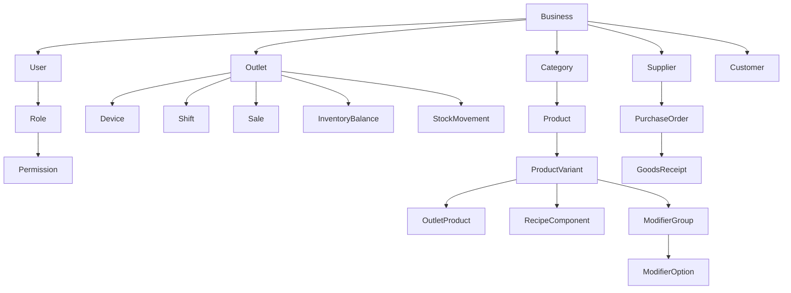

# Model Data

Dokumen ini menetapkan bentuk dan aturan data, bukan skema SQL final.

## 1. Prinsip

- Semua tabel bisnis memiliki `business_id` untuk isolasi tenant.
- Semua waktu tersimpan dalam UTC dan ditampilkan memakai zona waktu outlet.
- Uang disimpan sebagai integer satuan mata uang terkecil; untuk IDR berarti rupiah tanpa pecahan.
- Kuantitas memakai decimal dengan presisi yang disepakati untuk bahan baku.
- Record transaksi penting tidak dihapus permanen.
- Snapshot transaksi menjaga histori saat nama, harga, pajak, atau biaya produk berubah.
- Ledger pergerakan adalah sumber kebenaran stok; saldo adalah hasil agregasi/cache.

## 2. Relasi inti

## 3. Organisasi dan akses

### businesses

- `id`
- `name`
- `timezone_default`
- `currency`
- `status`

### outlets

- `id`, `business_id`
- `code`, `name`
- `address`
- `timezone`
- `receipt_prefix`
- `status`

### users

- `id`, `business_id`
- `name`, `email_or_phone`
- `password_hash`
- `pin_hash` opsional
- `status`, `last_login_at`

### roles, permissions, user_outlet_roles

Peran adalah kumpulan izin. Penugasan menyebut pengguna, outlet, dan peran agar seorang manajer tidak otomatis melihat semua outlet.

### devices

- `id`, `business_id`, `outlet_id`
- `code`, `name`, `platform`
- `installation_id`
- `last_seen_at`, `last_sync_at`
- `revoked_at`

## 4. Katalog

### categories

- `id`, `business_id`
- `parent_id` opsional, maksimal dua tingkat pada MVP
- `name`, `display_order`, `status`

### products

- `id`, `business_id`, `category_id`
- `name`, `description`, `image_path`
- `product_type`: `standard` atau `recipe`
- `tax_profile_id`
- `status`, `display_order`

### product_variants

- `id`, `business_id`, `product_id`
- `sku`, `barcode`, `name`
- `base_unit`
- `sell_price`, `cost_price`
- `track_stock`, `allow_negative_stock`
- `is_default`, `status`

Produk tanpa pilihan memiliki satu varian default. Semua baris penjualan menunjuk varian, bukan langsung ke produk.

### outlet_products

- `outlet_id`, `product_variant_id`
- `is_available`
- `price_override` opsional
- `low_stock_threshold` opsional

### modifier_groups dan modifier_options

Grup menyimpan nama, minimum, maksimum, dan apakah wajib. Opsi menyimpan nama, tambahan harga, serta SKU bahan opsional bila modifier memengaruhi stok.

### recipe_components

- `parent_variant_id`
- `component_variant_id`
- `quantity_in_base_unit`

MVP memakai satu base unit per SKU. Konversi unit pembelian yang kompleks ditunda sampai kebutuhan pilot jelas.

## 5. Penjualan

### sales

- `id`, `business_id`, `outlet_id`, `device_id`, `shift_id`
- `customer_id` opsional
- `receipt_number`, `device_sequence`, `idempotency_key`
- `status`: `draft`, `completed`, `voided`, `partially_refunded`, `refunded`
- `subtotal`, `discount_total`, `tax_total`, `service_charge_total`, `grand_total`
- `created_at_device`, `created_at_server`, `synced_at`
- `cashier_user_id`

### sale_lines

- `id`, `sale_id`, `product_variant_id`
- Snapshot: `product_name`, `variant_name`, `sku`, `unit`, `unit_price`, `unit_cost`, `tax_rate`
- `quantity`, `discount_total`, `tax_total`, `line_total`
- `note`

### sale_line_modifiers

- `sale_line_id`, `modifier_option_id`
- Snapshot nama, harga, biaya, dan jumlah.

### payments

- `id`, `sale_id`, `payment_method_id`
- `amount`, `status`, `external_reference`
- `idempotency_key`, `paid_at`

### refunds dan refund_lines

Refund menunjuk transaksi serta baris asli, menyimpan alasan, pelaku, penyetuju, nominal, dan keputusan pengembalian stok.

Tidak ada hard delete untuk `sales`, `sale_lines`, `payments`, atau `refunds`.

## 6. Shift dan kas

### shifts

- `id`, `outlet_id`, `device_id`, `opened_by`, `closed_by`
- `opening_cash`, `expected_cash`, `counted_cash`, `difference`
- `opened_at`, `closed_at`, `status`

### cash_movements

- `id`, `shift_id`
- `type`: `cash_in` atau `cash_out`
- `reason_id`, `amount`, `note`, `created_by`, `created_at`

Penjualan tunai tidak perlu diduplikasi sebagai `cash_movement`; kas yang diharapkan dihitung dari pembayaran tunai, refund tunai, dan pergerakan kas non-penjualan.

## 7. Persediaan

### stock_movements

- `id`, `business_id`, `outlet_id`, `product_variant_id`
- `movement_type`: `opening`, `sale`, `sale_return`, `purchase_receipt`, `transfer_out`, `transfer_in`, `adjustment`, `recipe_use`
- `quantity_delta`
- `unit_cost_snapshot`
- `source_type`, `source_id`
- `reason_id`, `occurred_at`, `created_by`

`quantity_delta` positif menambah stok dan negatif mengurangi stok.

### inventory_balances

- `outlet_id`, `product_variant_id`
- `quantity_on_hand`
- `average_cost`
- `updated_at`

Saldo diperbarui dalam transaksi database yang sama dengan penambahan ledger. Rekonsiliasi berkala membandingkan saldo dengan total ledger.

### stock_counts dan stock_count_lines

Menyimpan jumlah sistem saat mulai, jumlah fisik, selisih, status, penghitung, penyetuju, dan waktu posting.

### stock_transfers dan stock_transfer_lines

Status minimum: `draft`, `sent`, `received`, `cancelled`. Stok sumber berkurang saat dikirim; stok tujuan bertambah saat diterima.

## 8. Pembelian

### suppliers

- `id`, `business_id`
- `code`, `name`, `contact`, `address`, `status`

### purchase_orders dan purchase_order_lines

Menyimpan pemasok, outlet tujuan, nomor, status, tanggal, SKU, jumlah dipesan, biaya, pajak, dan catatan.

### goods_receipts dan goods_receipt_lines

Satu PO dapat memiliki beberapa penerimaan. Posting penerimaan membuat `stock_movements` dan memperbarui jumlah diterima.

## 9. Pelanggan

### customers

- `id`, `business_id`
- `name`
- `phone` opsional, terenkripsi bila kebijakan teknis menetapkannya
- `email` opsional
- `notes` opsional dan dibatasi akses
- `status`, `created_at`

Poin, saldo pelanggan, dan loyalty ledger ditunda.

## 10. Pajak dan harga

### tax_profiles

- `id`, `business_id`, `name`
- `calculation_type`: inclusive atau exclusive
- `rate`
- `status`

Aturan pembulatan ditetapkan satu kali untuk bisnis dan diuji dengan contoh nominal batas.

### payment_methods

- `id`, `business_id`, `name`, `type`
- `requires_reference`, `status`, `display_order`

## 11. Audit dan sinkronisasi

### audit_logs

- Pelaku, outlet, perangkat, tindakan, jenis record, ID record, waktu.
- Nilai sebelum/sesudah untuk tindakan sensitif yang relevan.
- IP dan metadata sesi untuk backoffice.

### sync_batches

- `device_id`, `cursor`, `started_at`, `completed_at`, `status`, `error_summary`

Idempotency pada transaksi dan pembayaran memakai unique constraint. Validasi aplikasi saja tidak cukup.

## 12. Constraint wajib

- SKU unik per bisnis bila diisi.
- Barcode unik per bisnis bila diisi.
- `idempotency_key` transaksi unik per bisnis.
- `idempotency_key` pembayaran unik per bisnis.
- Nomor struk unik per outlet.
- Jumlah, harga, diskon, pajak, dan total divalidasi server.
- Referensi lintas bisnis ditolak oleh database atau service boundary.
- Record yang sudah diposting tidak dapat diubah tanpa reversal.
